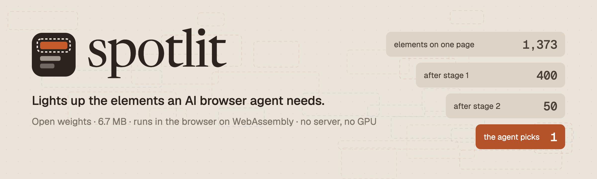

<picture>
  <source media="(prefers-color-scheme: dark)" srcset="docs/img/spotlit-banner-dark.png">
  
</picture>

# spotlit

spotlit is an open-weight model that ranks a web page's elements against an AI browser
agent's goal, so the agent sends its large model the 50 elements that matter instead of the
whole page. It is 6.7 MB, runs in the browser on WebAssembly with no server and no GPU, and
takes about a quarter of a second per page step on eight threads. On Mind2Web's three held-out
test splits, run once after the model was frozen, the element a person actually clicked is in
the top 50 on 80.8%, 75.8% and 75.9% of steps (cross-task, cross-website, cross-domain),
against about 44% for keyword search, while the agent reads 32-43x fewer tokens.

| Model | Files | Size | Parameters | Input | Description |
| :--- | :--- | ---: | ---: | :--- | :--- |
| **Stage 1** | `stage1.tlab` | 1.99 MB | 1.97M | Text as bytes, up to 512 | Hashed byte n-gram table (6,144 x 320, INT8), no tokenizer. Scores every element |
| **Stage 2** | `reranker.int8.onnx`, `vocab.txt` | 4.72 MB | 4.39M | Goal + element, 128 WordPiece tokens | BERT-tiny cross-encoder (INT8 ONNX). Re-scores stage 1's top 400 |
| **spotlit v1** | all three | 6.71 MB | 6.4M | A goal and a page | Both stages; returns the top 50 |

This repository holds the code that builds the training data from Mind2Web, trains both
stages, exports them to INT8, evaluates them, and runs them in the browser (JavaScript) and in
C++. To use the model, see the [model card](models/spotlit-v1/README.md) or download
the [v1.0.0 release](../../releases/tag/spotlit-v1.0.0). spotlit is built with tinylab, the
training toolkit in `python/tinylab`; the Python package and command-line tools keep that name.

## How it works

```
   web page: hundreds to thousands of elements
        |
   describe     each element as one line: tag, labels, own text | parent text
        |
   stage 1      2.0 MB  hashed byte n-grams, cosine with the goal       every element, 35-45 ms
        |  top 400
   stage 2      4.7 MB  BERT-tiny reads goal and element together       400 pairs, 185 ms
        |  top 50
   the agent's large model picks the action: click, type, select
```

1. **Describe.** Each element becomes one line: its tag, then its labels (`aria-label`,
   `title`, `alt`, `placeholder`, `name`, `type`, `role`, `value`, 60 characters each), up to
   24 words of its own text, then `|` and up to 12 words of its parent's text. A link reads
   `a Coffee & Tea | Coffee & Tea`.
2. **Goal.** The task plus up to three previous actions:
   `goal + " Previous actions: " + a; b; c`.
3. **Stage 1** cuts the goal and every element into overlapping 3, 4 and 5-byte pieces,
   hashes each piece into one of 6,144 rows, and averages the rows into a 320-dimensional
   vector. Elements are ranked by cosine with the goal. There is no vocabulary, so typos,
   case and punctuation change little.
4. **Stage 2** reads `[CLS] goal [SEP] element [SEP]` for each of stage 1's top 400 and gives
   it a score. Reading the pair together is what separates "Cancel" from "Subscribe" for the
   goal "Cancel my subscription", which share letters.
5. **The agent** receives the top 50 lines, a few hundred tokens, and chooses what to do.

## Results

Mind2Web test splits, run once after the files were frozen (sha256 in
[`manifest.json`](models/spotlit-v1/manifest.json)). Recall@50 is the share of steps
whose clicked element is in the top 50.

| System | Size | Cross-task | Cross-website | Cross-domain |
| :--- | ---: | ---: | ---: | ---: |
| Keyword search (BM25) | 0 | 44.2% | 43.8% | 44.5% |
| Stage 1 alone | 2.0 MB | 69.2% | 56.7% | 57.7% |
| **spotlit v1** | **6.7 MB** | **80.8%** | **75.8%** | **75.9%** |
| MindAct DeBERTa-v3-base, as reported in the Mind2Web paper | 184M params | 88.9% | 85.3% | 85.7% |

| Measure | Cross-task | Cross-website | Cross-domain |
| :--- | ---: | ---: | ---: |
| Steps | 2,094 | 1,373 | 5,911 |
| Recall@10 | 57.2% | 48.7% | 51.5% |
| Recall@100 | 85.8% | 82.3% | 83.6% |
| MRR | 0.274 | 0.219 | 0.251 |
| Tokens at the top 50 vs the page's cleaned HTML | 43x fewer | 34x fewer | 32x fewer |

Speed in Chrome 155 on an Apple M4 Pro, ONNX Runtime Web 1.30, medians over 38 dev steps:

| Setting | Re-score 400 pairs | Whole page step |
| :--- | ---: | ---: |
| 8 WebAssembly threads (cross-origin isolated page) | 185 ms | 236 ms |
| 1 thread (most hosted pages) | | about 1 s |

Every variant tried, the dev results and the runtime checks are in
[docs/benchmarks](docs/benchmarks/README.md).

## Strengths, weaknesses and limitations

**Strengths**

| Strength | Evidence |
| :--- | :--- |
| Small enough to ship with a page or an extension | 6.7 MB in three files. INT8 export moved dev recall@50 by +0.6 points |
| No server and no GPU | WebAssembly in Chrome: 236 ms per page step on 8 threads, about 1 s on one |
| Cuts what the agent sends | The top 50 is 32-43x fewer tokens than the cleaned HTML on the test splits |
| Holds up on websites it never saw | Cross-website and cross-domain recall@50 of 75.8% and 75.9%, 31-32 points above BM25. Dev agrees with these splits within 3 points |
| Tolerant of spelling and formatting | Stage 1 reads bytes: "Tokio tee ceremony" and "Tokyo tea ceremony" have cosine 0.69, and "Sign in" and "sign-in" are identical after normalising |
| Same answers in every runtime | Python, JavaScript and C++ agree: 31/31 encoder goldens, 667/667 WordPiece pairs, top 50 on 40/40 dev steps in Chrome |
| Open and reproducible | Apache-2.0 weights, MIT code, public training data, and every variant that failed is documented |

**Weaknesses**

| Weakness | Evidence | What it means |
| :--- | :--- | :--- |
| A shortlist, not a picker | Dev recall@1 is 10.9% and recall@10 is 49.3% | The agent's model still has to choose among the 50 |
| Misses about one step in four on new websites | Cross-website recall@50 is 75.8%; recall@100 is 82.3% | An agent needs a fallback: a larger k, or the full page |
| Behind larger rankers | MindAct's 184M-parameter ranker reports 8-10 points more recall@50 | BERT-mini (13.4 MB) was 6 points better on dev but took 1.2 s per step |
| Stage 1 caps stage 2 | Stage 1's top 400 holds the clicked element on 87.6% of dev steps | The other 12.4% can't be recovered by the re-ranker |
| Stage 1 memorizes websites | Its recall@50 on unseen websites stopped near 54% after 11k updates while training loss kept falling | The gains on new websites come from stage 2's pretraining |
| Near-synonyms and look-alikes | For "Sign in to my account", stage 2 ranks "Sign up free" first and "Log in" fifth | Unusual wording on a site can mislead it |

**Limitations**

| Limitation | Detail |
| :--- | :--- |
| English websites from 2023 | Trained on Mind2Web's English sites. Other languages and newer page structures are untested |
| Text only | Each element is one line of text. No screenshot, position, size or visibility |
| 128 tokens per pair | Stage 2 truncates the goal and element to 128 WordPiece tokens |
| Candidates from one document | `collectCandidates` reads up to 2,000 elements with one selector query. Elements inside iframes and shadow roots are not collected |
| Ranking only | It does not plan, scroll, fill forms or decide when a task is done |
| WebAssembly only for INT8 | ONNX Runtime Web 1.30's WebGPU backend returns wrong scores for the INT8 graph |
| Threads need cross-origin isolation | Without COOP and COEP headers the page runs on one thread, about 1 s per step |
| One more download | ONNX Runtime Web's engine is 14.2 MB, shared and cacheable |
| Offline evaluation | Recall on recorded pages, not task success. Tokens are estimated at 4 characters each. Steps whose clicked element is missing from the HTML (4-7%) count as misses |

## Use it

```js
import * as ort from "onnxruntime-web";
import * as spotlit from "./web/src/spotlit.js";

const ranker = await spotlit.load(ort, {
  stage1: "models/spotlit-v1/stage1.tlab",
  reranker: "models/spotlit-v1/reranker.int8.onnx",
  vocab: "models/spotlit-v1/vocab.txt",
});
const top50 = await ranker.rank("Find a store in Los Angeles", spotlit.collectCandidates(document));
```

`spotlit.load` returns a ranker. Its `rank(goal, candidates, { k, depth, history })` takes
`{ id, text }` candidates and returns the best `k` (default 50) with their scores and stage 1
ranks; `history` is the agent's previous actions. Run it on the `wasm` execution provider.
Stage 1 and the WordPiece tokenizer are dependency-free JavaScript in
[`web/src/`](web/README.md); stage 1 also has a C++ runtime in [`cpp/`](cpp/).

## Setup

Python 3.12 or 3.13 with [uv](https://docs.astral.sh/uv/), Node.js (tested on 23), and for the
C++ runtime a C++20 compiler and CMake. Training runs on Apple Silicon: stage 1 on MLX,
stage 2 on PyTorch with MPS.

```sh
uv sync --extra train --extra teacher --extra export
```

The `train` extra brings MLX, `teacher` brings Sentence Transformers (for the teacher model
and BERT-tiny), and `export` brings ONNX and ONNX Runtime.

## Data

```sh
uv run tinylab-build-mind2web                                # train split, about 6 GB downloaded
uv run tinylab-build-mind2web --test-password <password>     # also the three test splits
```

The data is [Mind2Web](https://github.com/OSU-NLP-Group/Mind2Web) (CC BY 4.0): 7,775
recorded steps on 73 websites in its training split, and three test splits. Nothing is
redistributed here; the builder downloads the source files, describes every candidate
element, and writes one line per step:

```
data/mind2web/train.jsonl        6,669 steps   training websites
data/mind2web/dev.jsonl          1,106 steps   10 websites never trained on, chosen by a salted hash
data/mind2web/test_task.jsonl    2,094 steps   } built only with --test-password,
data/mind2web/test_website.jsonl 1,373 steps   } used for evaluation only,
data/mind2web/test_domain.jsonl  5,911 steps   } and opened once
```

Each line holds the task, the previous actions, the operation, the candidate elements as
`[id, description]`, the clicked element's id and the size of the step's cleaned HTML. The
test password is in the Mind2Web README; its authors ask that the unzipped test data is never
redistributed or used for training.

Stage 1 starts from an earlier model, a 2 MB text embedder fitted on public technical and
design documents (six CQADupStack forums; Rust RFCs, Kubernetes enhancement proposals and
docs, Go and Swift proposals) labelled by `BAAI/bge-small-en-v1.5`. The commands to rebuild it are in
[python/tinylab/train](python/tinylab/train/README.md); its results are in
[docs/benchmarks/search-student.md](docs/benchmarks/search-student.md).

## Training

```sh
uv run tinylab-fit --tag design                  # the starting table, about a minute after labelling
uv run tinylab-train-ranker --tag v1             # stage 1, about 20 minutes on an M4 Pro
uv run tinylab-train-reranker --tag v1           # stage 2, about 6 minutes
```

**Stage 1: the n-gram table.** Starting from the 6,144 x 320 embedder table, it trains on
one page per update with a softmax over the clicked element and every other candidate on the
page, at temperature 0.05. Adam, learning rate 5e-4 with cosine decay, 3 epochs (18,804
updates), peak MLX memory 0.34 GB. Every 1,000 updates it logs recall on 400 dev steps.

**Stage 2: the re-ranker.** `google/bert_uncased_L-2_H-128_A-2` (BERT-tiny, Apache-2.0) as a
cross-encoder with 128-token pairs. Each batch holds 8 steps of 32 pairs: the clicked element
and 31 negatives drawn from stage 1's own top 400, with a softmax per step. AdamW, learning
rate 1e-4 with linear warmup and decay, 3 epochs (2,350 batches), 1.1 GB on MPS.
`--base google/bert_uncased_L-4_H-256_A-4` trains the BERT-mini variant.

## Export

```sh
uv run tinylab-export --checkpoint checkpoints/ranker-linear-6144x320-v1 --out dist/tinylab-ranker-v1
uv run tinylab-export-reranker --reranker checkpoints/reranker-bert_uncased_L-2_H-128_A-2-v1
```

The first writes stage 1 as a single-file `.tlab` (INT8 rows with one scale each, format in
[python/tinylab/export](python/tinylab/export/README.md)). The second writes the re-ranker as
FP32 and dynamically quantized INT8 ONNX, with `vocab.txt` and goldens (token ids and scores)
that the JavaScript runtime is checked against.

## Evaluation

```sh
uv run tinylab-rank-elements --teacher                                   # BM25 and untrained baselines on dev
uv run tinylab-rank-elements --checkpoint checkpoints/ranker-linear-6144x320-v1-int8 \
    --reranker dist/reranker-bert_uncased_L-2_H-128_A-2-v1/reranker.int8.onnx
uv run tinylab-rank-elements --steps data/mind2web/test_website.jsonl \
    --checkpoint checkpoints/ranker-linear-6144x320-v1-int8 \
    --reranker dist/reranker-bert_uncased_L-2_H-128_A-2-v1/reranker.int8.onnx
```

`tinylab-rank-elements` prints recall@1, 5, 10, 20, 50, 100 and 200, MRR and the token ratio
for BM25 and for each `--checkpoint`; `--reranker` re-ranks the first checkpoint's top 400.
Ties are broken by element id in stage 1 and by stage 1 rank in stage 2, never by the order of
Mind2Web's candidate list, which puts the clicked element first.

```sh
node web/test/parity.mjs                                                  # encoder and .tlab vs Python
node web/test/wordpiece-parity.mjs dist/reranker-bert_uncased_L-2_H-128_A-2-v1
cmake -S cpp -B cpp/build && cmake --build cpp/build && ctest --test-dir cpp/build
```

`web/bench-rerank.html` times a page step in the browser. Serve the repository with
`Cross-Origin-Opener-Policy: same-origin` and `Cross-Origin-Embedder-Policy: require-corp`
headers to get threads.

## Before spotlit

This project started as tinylab: a 2 MB, tokenizer-free text embedder to add to keyword search.
It adds +0.024 nDCG@10 to BM25 on technical prose but falls below BM25 on design documents, and
no variant tried (gradient training, bigger tables, multiple hashes, a small transformer)
closed the gap. Its table became stage 1's starting point. The record is in
[docs/benchmarks/search-student.md](docs/benchmarks/search-student.md).

## Repository

```
├── models/spotlit-v1/          the release: weights, manifest, model card, licence, credits
├── web/                        browser runtime: src/ (spotlit.js, tinylab.js, wordpiece.js), tests, bench pages
├── cpp/                        C++ runtime for the .tlab format, parity tests
├── python/tinylab/
│   ├── agent/                  spotlit: Mind2Web data, both stages, export, evaluation
│   ├── train/                  the starting table: closed-form fit, distillation
│   ├── export/                 .tlab writer (INT8, budget-checked)
│   ├── eval/                   retrieval evaluation harness, standard library only
│   ├── data/                   corpora, teacher labelling, word features
│   └── encoder.py              byte n-gram hashing, the frozen input contract
├── tests/                      golden vectors shared by Python, JavaScript and C++
└── docs/                       benchmarks/ (every measurement), img/ (logo, banner)
```

Writing code here follows [AGENTS.md](AGENTS.md).

## Licence

Code: MIT ([LICENSE](LICENSE)). Model weights: Apache-2.0
([models/spotlit-v1/LICENSE](models/spotlit-v1/LICENSE)), with credits for
Google's BERT miniatures, Mind2Web and the training text in
[NOTICE](models/spotlit-v1/NOTICE).
